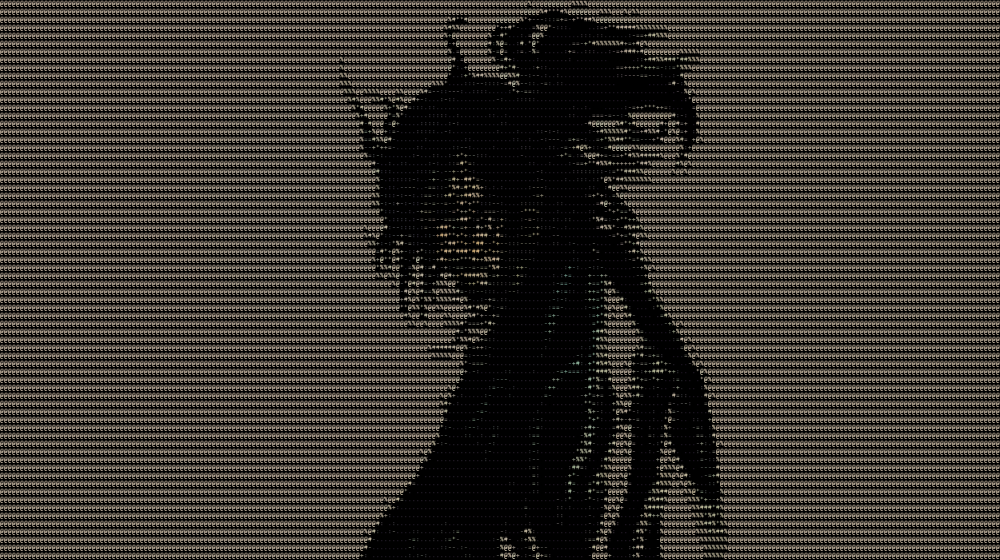

  
# WAKEUPMRANDERSON

Ronin of the terminal. Dual-wielding code and deadlines — one sword for the build, one for the ship.

  

 

## ⚔ Forged or Re-Forged by my hand

 

### 🗡 [Mindful-Next](https://github.com/WakeUpMrAnderson/Mindful-Next)

A minimal, private writing space in every new tab. A readable Chrome MV3 rebuild of
*Mindful (2016)* by Adrian Zumbrunnen — extended with an **AES-256-GCM encrypted note
vault**, a settings panel, remappable shortcuts, and Markdown/HTML export-import.
Unofficial continuation; all credit to the original creator.

`JavaScript` · `HTML` · `SCSS / CSS` · `Chrome Extension Manifest V3` · `Web Crypto API` · `esbuild` · `Playwright` · `GitHub Actions`

 

### 🌊 [Persian-Subtitle-Fixer](https://github.com/WakeUpMrAnderson/Persian-Subtitle-Fixer)

Fix your Persian subtitles. A desktop tool that repairs broken encoding and
subtitle files for Persian text, wrapped in a native-feeling GUI.

`Python` · `PyQt5` · `chardet` · `PyInstaller` · `ruff` · `uv` · `GitHub Actions`

 

## 🏯 The Way

> 1. Accept everything just the way it is.
> 2. Do not regret what you have done.
> 3. Be detached from desire your whole life.
> 4. Never depart from the Way.

— from the *Dokkōdō*, Musashi's twenty-one precepts, written a week before his death

